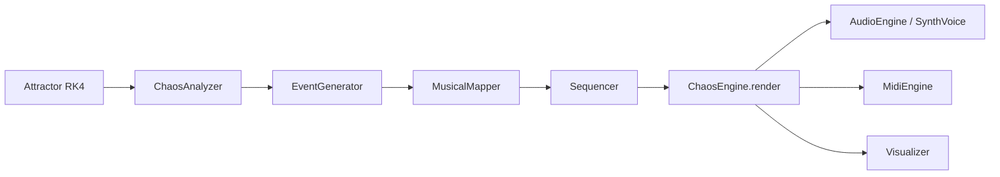

# Architecture

Lorenz is a real-time generative music system. A chaotic ODE produces a stream of `(x, y, z)` states; geometry of that trajectory becomes notes, rhythm, MIDI, and (in the browser) a simple synthesizer. The attractor never writes the audio waveform.

There are three deliverables that share the same musical contract:

| Target | License | Role |
|---|---|---|
| Web app (`js/`, Vite) | MIT | Interactive site with Web Audio + Web MIDI |
| Plugin (`plugin/`, JUCE) | AGPL-3.0 | MIDI effect (AU / VST3 / Standalone) that reimplements the sequencer in C++ and hosts the page as UI |
| Max for Live (`m4l/`) | MIT | Live MIDI Effect; bundles the shared `js/` pipeline and follows Live’s transport |

## Pipeline

```text
Chaotic flow (RK4)
    → trajectory { x, y, z, t, dx, dy, dz }
    → event detection (geometry)
    → density / voice routing
    → musical mapping (scale, velocity, duration, lobe)
    → clock mapping (sim time → audio / host time)
    → synthesis and/or MIDI
```



Every registered flow returns the same state shape, so stages after integration stay independent of the chosen equations.

## Design invariants

1. **Determinism** — Same system, parameters, and seed replay the same sequence. Probability density mode uses a seeded PRNG; otherwise routing is fully deterministic.
2. **Separation of concerns** — Attractors know nothing about notes; the analyzer knows nothing about scales; mappers never treat raw `x` as MIDI.
3. **Clock-agnostic render** — `ChaosEngine.render(start, end)` (JS) / `renderTo(endAudio, …)` (C++) advances simulation through an audio-time window. The web app calls it from a lookahead timer; the plugin calls it once per audio block.
4. **Shared preset JSON** — Website URL hashes, `localStorage`, library files under `presets/`, and plugin state all use the same `v: 2` snapshot shape.
5. **Lobes as musical states** — `x < 0` → lobe A, `x > 0` → lobe B (X zero-crossings use the *destination* wing). Lobes shape register, velocity, duration, pan, filter, and optional scale overrides — not *when* notes fire.

## Web modules (`js/`)

| Module | Responsibility |
|---|---|
| `attractors.js` | Seven-system registry + fixed-step RK4. Systems: Lorenz, Chua, Rössler, Thomas, Aizawa, Halvorsen, Rabinovich–Fabrikant. |
| `chaos-analyzer.js` | Zero crossings, extrema, Z thresholds, distance, velocity. Emits typed chaos events with lobe / direction. |
| `event-generator.js` | Density modes (`all`, `nth`, `probability`, `velocity-threshold`, `custom-threshold`) and per-voice event-type filters. |
| `musical-mapper.js` | Normalized features → scale degree, velocity, duration, register; lobe multipliers. |
| `sequencer.js` | Simulation time → audio clock; optional quantization blend via `timingInfluence`. |
| `engine.js` | Orchestrates the pipeline; lookahead scheduling; noteOn / noteOff queue; modulation enrichment. |
| `audio-engine.js` | `AudioContext`, master bus, voice map. |
| `synth-voice.js` | Oscillator, ADSR, low-pass, pan (browser-only). |
| `midi-engine.js` | Web MIDI output. |
| `visualizer.js` | Canvas trail, HUD, note markers. |
| `presets.js` | Capture / apply / hash URL / catalog / localStorage. |
| `plugin-host.js` | When loaded inside the JUCE WebView: mirror host state, draw frames, publish presets back. |
| `rng.js` | Seeded PRNG and hash helpers. |
| `app.js` | DOM wiring, control panel, play/pause, preset UI, engine construction. |

### Default voice routing

| Voice | Chaos source | Typical role |
|---|---|---|
| 1 | X zero-crossings | Bass / primary sequence |
| 2 | Y maxima / minima | Faster inner melody |
| 3 | Z threshold crossings | Percussive hits |

### Default feature map (before lobe offsets)

| Feature | Maps to |
|---|---|
| Y (normalized) | Scale degree |
| Distance from origin | Octave register |
| Z | Velocity |
| Trajectory speed | Duration (faster → shorter) |

## Plugin (`plugin/`)

```text
DAW transport
    → LorenzAudioProcessor::processBlock
    → lorenz::ChaosEngine::renderTo
    → MidiBuffer (noteOn / noteOff / pan CC)
    → Viz frames to PluginEditor WebView
```

| Piece | Role |
|---|---|
| `Engine/ChaosEngine.{hpp,cpp}` | C++ port of the musical pipeline (attractor → MIDI events). No built-in synth — MIDI effect only. |
| `PluginProcessor` | Owns the engine, applies preset JSON, syncs to host playhead, emits MIDI, buffers viz points/notes. |
| `PluginEditor` | Embeds the website; UI edits publish presets; host pushes `state` / `frame` events. |

Play follows the DAW transport. Reset / Perturb restart the sequence at the current playhead. `lorenz_engine_test` checks the C++ renderer against a JS-produced fixture CSV; `lorenz_host_test` covers transport and preset state.

Build: CMake + JUCE 9.0.5 → AU, VST3, Standalone.

## Max for Live (`m4l/`)

```text
Live transport (is_playing / tempo / current_song_time)
    → [js lorenz.js]
    → Lorenz.createLorenzDevice (bundled js/ pipeline)
    → midiformat → midiout
```

| Piece | Role |
|---|---|
| `pipeline.js` | Headless device factory over the shared `js/` modules (MIDI only). |
| `chaos-pipeline.js` | Vite IIFE bundle (`npm run build:m4l`) exposing global `Lorenz`. |
| `lorenz.js` | Max host: transport mapping, note on/off, preset/`set` messages. |
| `Lorenz.maxpat` | Patcher UI + Live observers; save as a Max MIDI Effect (`.amxd`) from Max. |

Same `v:2` preset JSON as the site and JUCE plugin. Details: [m4l/README.md](m4l/README.md).

## Presets

Versioned JSON (`"v": 2`) with a flat `params` object: system id, attractor coefficients, seed/`x0`–`z0`, harmony, lobe settings, rhythm, density, voices, synth, modulation.

Share mechanisms:

- `#p=…` — full encoded snapshot in the URL
- `#preset=name` — library file from `presets/` (listed in `presets/index.json`)
- Browser **Save** — `localStorage` only (not portable via link)

## Build, deploy, test

| Concern | How |
|---|---|
| Dev server | `npm run dev` (Vite, `base: "./"`) |
| Site build | `npm run build` → `dist/` (+ copied `presets/`) |
| Pages deploy | `.github/workflows/deploy-pages.yml` on `main` |
| Plugin release | `.github/workflows/release-plugins.yml` on `v*.*.*` tags |
| JS tests | Node test runner: pipeline determinism, attractor bounds, presets, MIDI, render, M4L device |
| M4L bundle | `npm run build:m4l` → `m4l/chaos-pipeline.js` |

## Related docs

- [README.md](README.md) — overview, run instructions, pipeline table
- [TUTORIAL.md](TUTORIAL.md) — first listen and control walkthrough
- [LOBES.md](LOBES.md) — lobe assignment, formulas, experiments
- [plugin/README.md](plugin/README.md) — plugin build products and host behavior
- [m4l/README.md](m4l/README.md) — Max for Live install and messages
